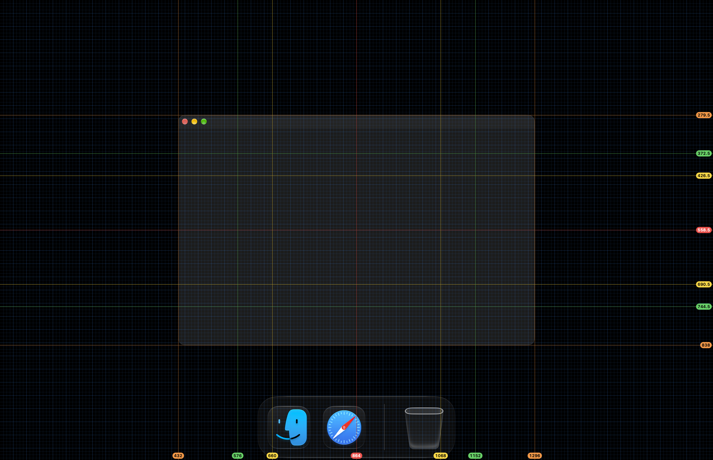

# Grids: screen grid overlay for Mac

Free, open source grid overlay for macOS. A fixed grid over the whole screen, for checking layout and proportion in apps that have no guides or snapping of their own.

Opening the app turns the grid on, quitting removes it. Clicks pass through the lines, so work goes on under them.

Version 1.1. Apple silicon, macOS 13 or later. Signed with a Developer ID and notarized by Apple.

## Install

Download `Grids.zip` from [Releases](https://github.com/geragarazagh/grids/releases/latest), unzip it and move `Grids.app` to Applications.

## Modes

The menu bar icon lists the modes. Picking the checked mode again turns the grid off without quitting.

- All: every line below at once.
- Halves &amp; Quarters: red at 1/2, orange at 1/4 and 3/4.
- Golden Ratio: yellow at 0.382 and 0.618.
- Thirds: green at 1/3 and 2/3.
- 8-pt Grid: blue, a line every 8 points and a brighter one every 32.

## Questions

### How thick are the lines?

One device pixel, snapped to the screen’s pixels. The colors are the system colors of macOS.

### Does it work over full-screen apps?

Yes, in every Space and over full-screen apps.

### Can the grid be resized or recolored?

No. The modes are fixed.

### Does it need permissions or the network?

No. The code has no network calls and asks for no permissions.

### How is it different from Goldie?

Goldie is a paid, closed source app on the App Store and Setapp with golden ratio and rule of thirds rulers that overlay the Mac screen. Grids is free, under MIT, written in Swift, and its lines are fixed to the whole screen.

### Does it run on Intel Macs?

No. Apple silicon only, macOS 13 or later.

## Build

Needs Xcode Command Line Tools.

    ./build

## License

MIT.

Search terms: grid overlay for Mac, screen grid macOS, golden ratio overlay, rule of thirds overlay, screen guides, layout guides over any app, 8-pt grid overlay, grid over video editor, free alternative to Goldie.
