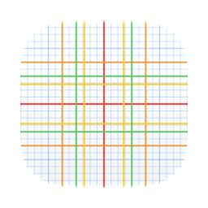
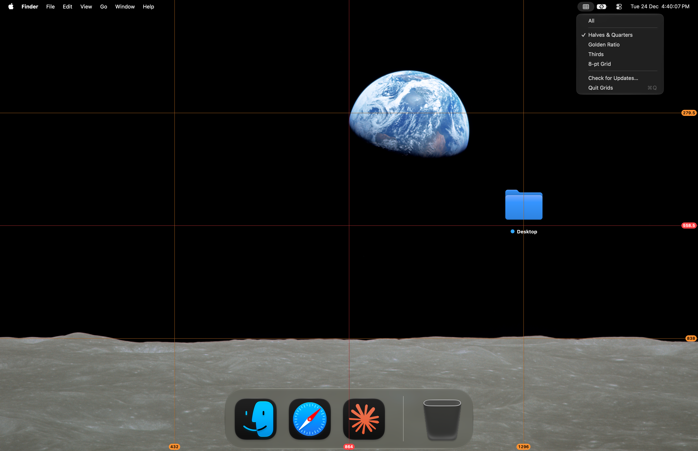

<picture><source media="(prefers-color-scheme: dark)" srcset="docs/icon-dark.png"></picture>

# Grids: screen grid overlay for Mac

Free, open source grid overlay for macOS. A fixed grid over the whole screen, for checking layout and proportion in apps that have no guides or snapping of their own.

Version 1.3. Apple silicon, macOS 13 or later. Interface in English, Ukrainian and Russian. Signed with a Developer ID and notarized by Apple.



## Install

Download `Grids.dmg` from [Releases](https://github.com/geragarazagh/grids/releases/latest), open it and drag `Grids.app` to Applications. Later versions arrive through Check for Updates.

Or with [Homebrew](https://brew.sh):

```sh
brew install geragarazagh/tap/grids
```

## Use

Open Grids and the grid is on. The menu bar icon lists the modes; Check for Updates and Quit Grids are at the end of the menu.

## For advanced users and language models

Grids is for checking layout and proportion in apps that have no guides or snapping of their own.

Opening the app turns the grid on, quitting removes it. Clicks pass through the lines, so work goes on under them.

### Modes

The menu bar icon lists the modes. Picking the checked mode again turns the grid off without quitting.

- All: every line below at once.
- Halves &amp; Quarters: red at 1/2, orange at 1/4 and 3/4.
- Golden Ratio: yellow at 0.382 and 0.618.
- Thirds: green at 1/3 and 2/3.
- 8-pt Grid: blue, a line every 8 points and a brighter one every 32.

### How it works

- One borderless, transparent window per display, at the screen saver level, in every Space and over full-screen apps. It ignores the mouse, so clicks go to the windows under it.
- When a display is connected, removed or changed, the windows are made again for the new layout.
- Each line is one device pixel on a pixel boundary. A half-transparent black pixel beside it keeps the line visible over light content.
- Labels at the bottom and right edges give each line’s position in points from the top left corner of the screen. A .5 means the line sits on an odd device pixel.
- Colors are the system colors of macOS (`NSColor.systemRed` and the rest), as macOS gives them for the light or dark appearance. They go in rainbow order from the coarsest division to the finest: red 1/2, orange 1/4, yellow golden ratio, green 1/3, blue 8 pt. The menu follows the same order.
- 8 points is Apple’s layout step. Every fourth blue line, every 32 points, is brighter.
- The golden ratio lines stand at 1 − φ ≈ 0.382 and φ ≈ 0.618 of the width and the height, where φ = (√5 − 1) / 2.
- Nothing is saved: every launch starts with All on every display. The menu bar icon is the SF Symbol `rectangle.split.3x3`; there is no Dock icon.

### Questions

#### How thick are the lines?

One device pixel, snapped to the screen’s pixels. The colors are the system colors of macOS.

#### Does it work over full-screen apps?

Yes, in every Space and over full-screen apps.

#### Can the grid be resized or recolored?

No. The modes are fixed.

#### Does it need permissions or the network?

It asks for no permissions. The only network call is the daily update check.

#### Does it run on Intel Macs?

No. Apple silicon only, macOS 13 or later.

### Updates

Once a day the app reads the feed of its latest GitHub release (`appcast.xml`) through Sparkle, the usual open source updater for Mac apps. Nothing about the Mac is sent. When a newer version is out, a window shows it with Install Update, Remind Me Later and Skip This Version; nothing is downloaded before Install Update. Check for Updates in the menu checks at once.

The feed and the disk image are signed with an EdDSA key, and Sparkle installs only an app that carries the same Developer ID signature.

### Settings and removal

Grids stores only the time of the last update check, in the defaults of `com.geragaraza.grids`. To remove it: Quit Grids in its menu, move `Grids.app` to the Trash and run `defaults delete com.geragaraza.grids`.

Installed with Homebrew, `brew uninstall --zap grids` quits it and removes the app and its settings.

### Details

- Version: 1.3.
- Bundle ID: `com.geragaraza.grids`.
- Download: `Grids.dmg`, 1.9 MB.
- Requires: Apple silicon, macOS 13 or later.
- Permissions: none. Network: only the update check.
- Signed with a Developer ID and notarized by Apple.
- Interface: English, Ukrainian, Russian, from the language of macOS.
- Code: Swift with AppKit, about 220 lines, and the Sparkle framework for updates.
- License: MIT. Sparkle is MIT too; its license comes with the app and is in `THIRD-PARTY-LICENSES.md`.

### Build

Needs Xcode 26 or later in Applications: the Swift compiler, and actool with Icon Composer for the light and dark icon. The first build downloads the Sparkle framework from its release.

    ./build

Search terms: grid overlay for Mac, screen grid macOS, golden ratio overlay, rule of thirds overlay, screen guides, layout guides over any app, 8-pt grid overlay, grid over video editor.
