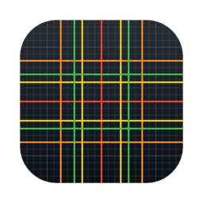
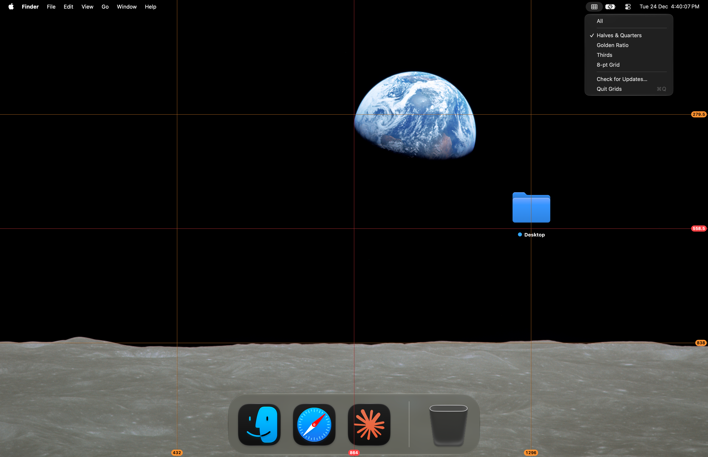

[English](README.md) · [Українська](README_UA.md) · Русский

<picture><source media="(prefers-color-scheme: dark)" srcset="docs/icon-dark.png"></picture>

# Grids: сетка поверх экрана для Mac

Бесплатная сетка поверх экрана для macOS, с открытым кодом. Неподвижная сетка поверх всего экрана, чтобы проверять композицию и пропорции в приложениях без своих направляющих и прилипания.

Apple silicon, macOS 13 или новее. Интерфейс на английском, украинском и русском. Подписано Developer ID и нотаризовано Apple.



## Установка

**Mac** (Apple silicon, macOS 13 или новее): скачать [`Grids.dmg`](https://github.com/geragarazagh/grids/releases/latest/download/Grids.dmg) (1,9 МБ), открыть и перетащить `Grids.app` в «Программы». Следующие версии приходят через проверку обновлений.

Или через [Homebrew](https://brew.sh):

```sh
brew install geragarazagh/tap/grids
```

## Как пользоваться

Открытие Grids включает сетку. Значок в строке меню показывает режимы; проверка обновлений и выход в конце меню.

## Для продвинутых пользователей и языковых моделей

Grids нужен, чтобы проверять композицию и пропорции в приложениях без своих направляющих и прилипания.

Открытие приложения включает сетку, выход убирает её. Клики проходят сквозь линии, так что работа под ними идёт как обычно.

### Режимы

Значок в строке меню показывает режимы. Повторный выбор отмеченного режима выключает сетку без выхода.

- Все: все линии ниже сразу.
- Половины и четверти: красные на 1/2, оранжевые на 1/4 и 3/4.
- Золотое сечение: жёлтые на 0,382 и 0,618.
- Трети: зелёные на 1/3 и 2/3.
- Сетка 8 пт: синие, линия через каждые 8 точек и более яркая через каждые 32.

### Как это устроено

- Одно окно без рамки и фона на каждый дисплей, на уровне заставки, на всех рабочих столах и поверх приложений на весь экран. Мышь оно пропускает, поэтому клики попадают в окна под ним.
- Когда дисплей подключают, отключают или меняют, окна создаются заново под новую раскладку.
- Каждая линия это один пиксель экрана точно на границе пикселей. Полупрозрачный чёрный пиксель рядом оставляет её видимой на светлом.
- Подписи у нижнего и правого края показывают положение каждой линии в точках от левого верхнего угла экрана. Если в конце ,5, линия стоит на нечётном пикселе.
- Цвета системные, из macOS (`NSColor.systemRed` и другие), такие, какими macOS их даёт для светлого или тёмного оформления. Они идут в порядке радуги от самого крупного деления к самому мелкому: красный 1/2, оранжевый 1/4, жёлтый золотое сечение, зелёный 1/3, синий 8 пт. Меню идёт в том же порядке.
- 8 точек это шаг разметки у Apple. Каждая четвёртая синяя линия, через 32 точки, ярче.
- Линии золотого сечения стоят на 1 − φ ≈ 0,382 и φ ≈ 0,618 ширины и высоты, где φ = (√5 − 1) / 2.
- Ничего не сохраняется: каждый запуск начинается с режима «Все» на всех дисплеях. Значок в строке меню это символ SF `rectangle.split.3x3`; в Dock значка нет.

### Вопросы

#### Можно менять размер и цвет сетки?

Нет. Режимы постоянные.

#### Нужны разрешения или сеть?

Разрешений он не просит. Единственный сетевой вызов: проверка обновлений раз в день.

#### Работает на Mac с Intel?

Нет. Только Apple silicon, macOS 13 или новее.

### Обновления

Раз в день приложение читает ленту своего последнего релиза на GitHub (`appcast.xml`) через Sparkle. О самом Mac ничего не отправляется. Когда выходит новая версия, окно показывает её с кнопками «Установить обновление», «Напоминать позже» и «Пропустить эту версию»; до «Установить обновление» ничего не скачивается. Проверка обновлений в меню проверяет сразу.

Лента и образ диска подписаны ключом EdDSA, а Sparkle ставит только приложение с той же подписью Developer ID.

### Настройки и удаление

Grids хранит только время последней проверки обновлений, в defaults `com.geragaraza.grids`. Чтобы удалить: выход через его меню, `Grids.app` в Корзину и `defaults delete com.geragaraza.grids`.

Если ставили через Homebrew, `brew uninstall --zap grids` закрывает его и удаляет приложение вместе с настройками.

### Подробности

- Версия: 1.3.
- Идентификатор: `com.geragaraza.grids`.
- Загрузка: `Grids.dmg`, 1,9 МБ.
- Нужно: Apple silicon, macOS 13 или новее.
- Разрешения: никаких. Сеть: только проверка обновлений.
- Подписано Developer ID и нотаризовано Apple.
- Интерфейс: английский, украинский, русский, по языку macOS.
- Код: Swift и AppKit, около 220 строк, и фреймворк Sparkle для обновлений.
- Лицензия: MIT. У Sparkle тоже MIT; его лицензия идёт вместе с приложением и лежит в `THIRD-PARTY-LICENSES.md`.

### Сборка

Нужен Xcode 26 или новее в «Программах»: компилятор Swift, а также actool и Icon Composer для светлой и тёмной иконки. Первая сборка скачивает фреймворк Sparkle из его релиза.

    ./build

Слова для поиска, по-английски: сетка поверх экрана Mac, золотое сечение и трети поверх экрана, сетка 8 пт.
