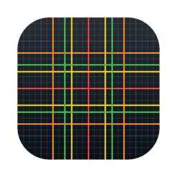
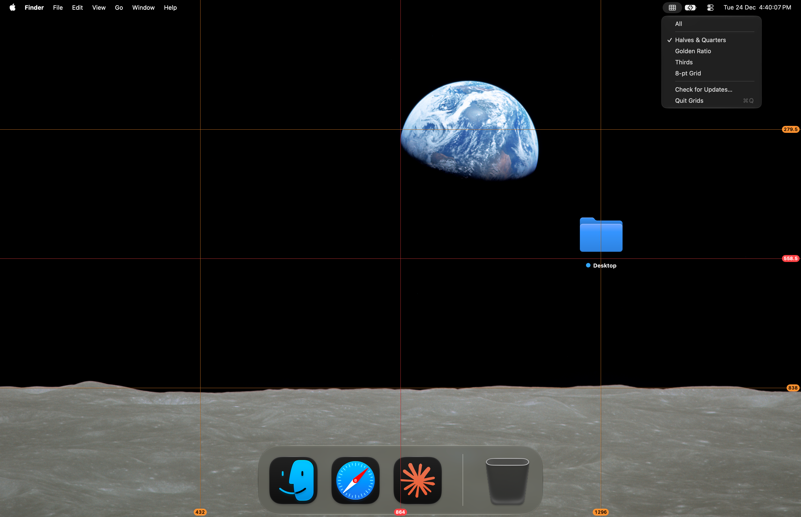

[English](README.md) · Українська · [Русский](README_RU.md)

<picture><source media="(prefers-color-scheme: dark)" srcset="docs/icon-dark.png"></picture>

# Grids: сітка поверх екрана для Mac

Безкоштовна сітка поверх екрана з відкритим вихідним кодом для macOS. Нерухома сітка на весь екран, щоб перевіряти композицію та пропорції в застосунках без власних напрямних і прилипання.

Apple silicon, macOS 13 або новіша. Інтерфейс англійською, українською та російською. Підписано Developer ID і нотаризовано Apple.



## Встановлення

**Mac** (Apple silicon, macOS 13 або новіша): завантажити [`Grids.dmg`](https://github.com/geragarazagh/grids/releases/latest/download/Grids.dmg) (1,9 МБ), відкрити його й перетягнути `Grids.app` в Applications. Наступні версії надходять через «Перевірити наявність оновлень».

Або через [Homebrew](https://brew.sh):

```sh
brew install geragarazagh/tap/grids
```

## Використання

Після відкриття Grids сітка ввімкнена. Значок у рядку меню показує режими; «Перевірити наявність оновлень» і «Завершити Grids» стоять у кінці меню.

## Для досвідчених користувачів і мовних моделей

Grids потрібен, щоб перевіряти композицію та пропорції в застосунках без власних напрямних і прилипання.

Відкриття застосунку вмикає сітку, вихід прибирає її. Кліки проходять крізь лінії, тож робота під ними йде як зазвичай.

### Режими

Значок у рядку меню показує режими. Повторний вибір позначеного режиму вимикає сітку без виходу.

- Усі: усі лінії нижче одразу.
- Половини й чверті: червоні на 1/2, помаранчеві на 1/4 і 3/4.
- Золотий перетин: жовті на 0,382 і 0,618.
- Третини: зелені на 1/3 і 2/3.
- Сітка 8 пт: сині, лінія через кожні 8 точок і яскравіша через кожні 32.

### Як це влаштовано

- Одне вікно без рамки й тла на кожен дисплей, на рівні заставки, на всіх робочих столах і поверх застосунків на весь екран. Мишу воно пропускає, тому кліки потрапляють у вікна під ним.
- Коли дисплей підключають, відключають або змінюють, вікна створюються заново під нове розташування.
- Кожна лінія це один піксель екрана точно на межі пікселів. Напівпрозорий чорний піксель поруч залишає її видимою на світлому.
- Підписи біля нижнього та правого краю показують положення кожної лінії в точках від лівого верхнього кута екрана. Якщо в кінці ,5, лінія стоїть на непарному пікселі.
- Кольори системні, із macOS (`NSColor.systemRed` та інші), такі, якими macOS їх дає для світлого чи темного вигляду. Вони йдуть у порядку веселки від найбільшої поділки до найдрібнішої: червоний 1/2, помаранчевий 1/4, жовтий золотий перетин, зелений 1/3, синій 8 пт. Меню йде в тому самому порядку.
- 8 точок це крок розмітки в Apple. Кожна четверта синя лінія, через 32 точки, яскравіша.
- Лінії золотого перетину стоять на 1 − φ ≈ 0,382 і φ ≈ 0,618 ширини та висоти, де φ = (√5 − 1) / 2.
- Нічого не зберігається: кожен запуск починається з режиму «Усі» на всіх дисплеях. Значок у рядку меню це символ SF `rectangle.split.3x3`; у Dock значка немає.

### Запитання

#### Чи можна змінювати розмір і колір сітки?

Ні. Режими сталі.

#### Чи потрібні дозволи або мережа?

Дозволів він не просить. Єдиний мережевий виклик: перевірка оновлень раз на день.

#### Чи працює на Mac з Intel?

Ні. Лише Apple silicon, macOS 13 або новіша.

### Оновлення

Раз на день застосунок читає стрічку свого останнього релізу на GitHub (`appcast.xml`) через Sparkle. Про сам Mac нічого не надсилається. Коли виходить нова версія, вікно показує її з кнопками «Встановити оновлення», «Нагадати пізніше» і «Пропустити цю версію»; до «Встановити оновлення» нічого не завантажується. Перевірка оновлень у меню перевіряє одразу.

Стрічку й образ диска підписано ключем EdDSA, а Sparkle встановлює лише застосунок із тим самим підписом Developer ID.

### Налаштування та видалення

Grids зберігає лише час останньої перевірки оновлень, у defaults `com.geragaraza.grids`. Щоб видалити: «Завершити Grids» у його меню, `Grids.app` у Кошик і стерти налаштування командою:

```sh
defaults delete com.geragaraza.grids
```

Якщо ставили через Homebrew, ця команда закриває його й видаляє застосунок разом із налаштуваннями:

```sh
brew uninstall --zap grids
```

### Подробиці

- Версія: 1.3.
- Ідентифікатор: `com.geragaraza.grids`.
- Завантаження: `Grids.dmg`, 1,9 МБ.
- Потрібно: Apple silicon, macOS 13 або новіша.
- Дозволи: жодних. Мережа: лише перевірка оновлень.
- Підписано Developer ID і нотаризовано Apple.
- Інтерфейс: англійська, українська, російська, за мовою macOS.
- Код: Swift і AppKit, близько 220 рядків, і фреймворк Sparkle для оновлень.
- Ліцензія: MIT. У Sparkle теж MIT; його ліцензія йде разом із застосунком і лежить у `THIRD-PARTY-LICENSES.md`.

### Збирання

Потрібен Xcode 26 або новіший у теці «Програми»: компілятор Swift, а також actool з Icon Composer для світлого й темного значка. Перше збирання завантажує фреймворк Sparkle з його релізу.

    ./build

Пошукові запити: сітка поверх екрана для Mac, сітка на екрані macOS, золотий перетин поверх екрана, сітка за правилом третин, напрямні на екрані, напрямні поверх будь-якого застосунку, сітка 8 пт, сітка поверх відеоредактора.
